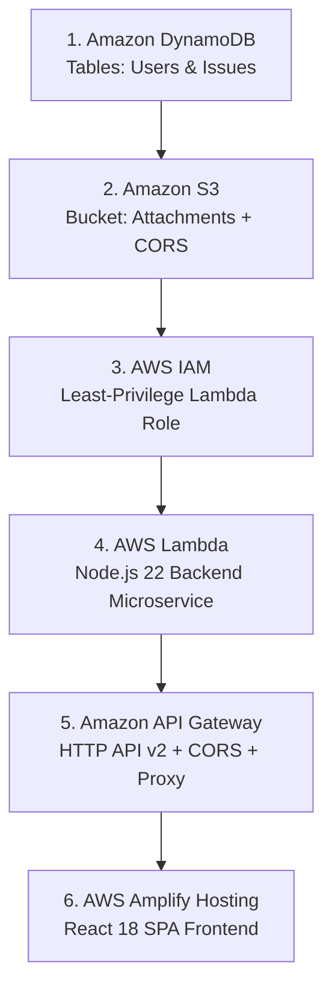

# SWADESH AWS Cloud Setup & Deployment Checklist
Single Source of Truth: Derived directly from codebase audit and `docs/BLUEPRINT.md`.

This document lists, in exact provisioning order, every AWS cloud resource, schema, permission policy, and environment variable required to deploy and operate the SWADESH civic issue redressal platform in production on AWS.

---

## 📋 Provisioning Sequence Overview



---

## Step 1: Amazon DynamoDB Tables

Region: **`us-east-1`** (US East - N. Virginia)  
Capacity Mode: **On-Demand (`PAY_PER_REQUEST`)**

### 1.1 Users Table
- **Table Name**: `swadesh-users` (driven by `USERS_TABLE` env var)
- **Partition Key (PK)**: `userId` (String, format `u_<12-hex-sha256>`)
- **Sort Key (SK)**: None
- **Attributes Stored**:
  - `userId` (S)
  - `name` (S)
  - `email` (S, lowercase)
  - `role` (S, `citizen` | `authority`)
  - `createdAt` (S, ISO-8601 UTC)
  - `updatedAt` (S, ISO-8601 UTC)
- **Point-in-Time Recovery (PITR)**: Enabled

### 1.2 Issues Table & Global Secondary Indexes (GSIs)
- **Table Name**: `swadesh-issues` (driven by `ISSUES_TABLE` env var)
- **Partition Key (PK)**: `issueId` (String, format `iss_<12-hex-random>`)
- **Sort Key (SK)**: None
- **Attributes Stored**:
  - `issueId` (S)
  - `title` (S)
  - `description` (S)
  - `category` (S: `POTHOLE`, `GARBAGE`, `STREETLIGHT`, `WATER_LEAKAGE`, `DRAINAGE`, `OTHER`)
  - `location` (M: `{ address: S, lat?: N, lng?: N }`)
  - `imageKey` (S: `issues/<id>/<filename>`)
  - `status` (S: `PENDING_VERIFICATION`, `VERIFIED`, `ASSIGNED`, `IN_PROGRESS`, `RESOLVED`, `REJECTED`)
  - `priority` (S: `LOW`, `MEDIUM`, `HIGH` or Null)
  - `department` (S: `ROADS`, `SANITATION`, `ELECTRICAL`, `WATER`, `PARKS` or Null)
  - `assignedTo` (S or Null)
  - `reporterId` (S)
  - `reporterName` (S)
  - `upvoteCount` (N)
  - `upvotedBy` (SS - DynamoDB String Set: stores unique `userId`s, internal never returned)
  - `statusHistory` (L - List of Maps: `[{ status: S, by: S, note: S, at: S }]`)
  - `createdAt` (S, ISO-8601 UTC)
  - `updatedAt` (S, ISO-8601 UTC)
- **Global Secondary Index 1 (Status Index)**:
  - **Index Name**: `gsi_status_createdAt`
  - **Partition Key**: `status` (String)
  - **Sort Key**: `createdAt` (String)
  - **Projected Attributes**: `ALL`
- **Global Secondary Index 2 (Reporter Index)**:
  - **Index Name**: `gsi_reporter_createdAt`
  - **Partition Key**: `reporterId` (String)
  - **Sort Key**: `createdAt` (String)
  - **Projected Attributes**: `ALL`
- **Point-in-Time Recovery (PITR)**: Enabled

---

## Step 2: Amazon S3 Bucket (Attachment Storage)

The S3 bucket stores citizen-uploaded grievance photos. S3 presigned PUT/GET URLs are generated by Lambda so photos flow directly between the user's browser and S3 without compute bottlenecks.

- **Bucket Name**: e.g., `swadesh-attachments-<aws-account-id>-us-east-1` (driven by `IMAGE_BUCKET` env var)
- **Region**: `us-east-1`
- **Block Public Access**: **All 4 settings ENABLED** (Bucket remains 100% private; zero public object ACLs)
- **Default Encryption**: Server-Side Encryption with Amazon S3 managed keys (`SSE-S3`)
- **Bucket CORS Configuration**:
  *Allows web browsers to PUT uploaded images directly to presigned S3 URLs:*
  ```json
  [
    {
      "AllowedHeaders": ["*"],
      "AllowedMethods": ["GET", "PUT"],
      "AllowedOrigins": [
        "https://*.amplifyapp.com",
        "https://swadesh.yourdomain.com",
        "http://localhost:5173"
      ],
      "ExposeHeaders": ["ETag"],
      "MaxAgeSeconds": 3600
    }
  ]
  ```

---

## Step 3: AWS IAM Least-Privilege Execution Role

Create role **`swadesh-lambda-execution-role`** assumed by service **`lambda.amazonaws.com`**.

### 3.1 Trust Policy
```json
{
  "Version": "2012-10-17",
  "Statement": [
    {
      "Effect": "Allow",
      "Principal": { "Service": "lambda.amazonaws.com" },
      "Action": "sts:AssumeRole"
    }
  ]
}
```

### 3.2 Permission Policy: `swadesh-lambda-least-privilege`
```json
{
  "Version": "2012-10-17",
  "Statement": [
    {
      "Sid": "CloudWatchLogs",
      "Effect": "Allow",
      "Action": [
        "logs:CreateLogGroup",
        "logs:CreateLogStream",
        "logs:PutLogEvents"
      ],
      "Resource": "arn:aws:logs:us-east-1:*:log-group:/aws/lambda/swadesh-api:*"
    },
    {
      "Sid": "DynamoDBUsersTable",
      "Effect": "Allow",
      "Action": [
        "dynamodb:GetItem",
        "dynamodb:PutItem"
      ],
      "Resource": "arn:aws:dynamodb:us-east-1:*:table/swadesh-users"
    },
    {
      "Sid": "DynamoDBIssuesTableAndGSIs",
      "Effect": "Allow",
      "Action": [
        "dynamodb:GetItem",
        "dynamodb:PutItem",
        "dynamodb:UpdateItem",
        "dynamodb:Query",
        "dynamodb:Scan"
      ],
      "Resource": [
        "arn:aws:dynamodb:us-east-1:*:table/swadesh-issues",
        "arn:aws:dynamodb:us-east-1:*:table/swadesh-issues/index/*"
      ]
    },
    {
      "Sid": "S3PresignedAccess",
      "Effect": "Allow",
      "Action": [
        "s3:PutObject",
        "s3:GetObject"
      ],
      "Resource": "arn:aws:s3:::swadesh-attachments-*-us-east-1/issues/*"
    }
  ]
}
```

---

## Step 4: AWS Lambda Function

- **Function Name**: `swadesh-api`
- **Runtime**: `Node.js 22.x` (`nodejs22.x`)
- **Architecture**: `x86_64` (or `arm64`)
- **Execution Role**: `swadesh-lambda-execution-role`
- **Handler**: **`index.handler`**
- **Code Package**: Upload [`backend/dist/function.zip`](file:///c:/Users/NIKUNJ/OneDrive/Desktop/SWADESH%20CCL/backend/dist/function.zip) (generated via `npm run package`)
- **Memory**: `512 MB`
- **Timeout**: `15 seconds`
- **Environment Variables**:

| Variable Key | Production Setting | Description |
|---|---|---|
| `DATA_STORE` | `dynamo` | Activates DynamoDB client instead of local memory |
| `S3_MODE` | `aws` | Activates AWS S3 presigned URL generator |
| `ISSUES_TABLE` | `swadesh-issues` | Name of issues table |
| `USERS_TABLE` | `swadesh-users` | Name of users table |
| `IMAGE_BUCKET` | `swadesh-attachments-<account-id>-us-east-1` | S3 bucket created in Step 2 |
| `JWT_SECRET` | *(64-hex random string)* | Strong secret key for signing HS256 auth tokens |
| `AUTHORITY_PASSCODE` | *(Secret municipal passcode)* | Required during authority login |
| `LOG_LEVEL` | `INFO` | Emits single structured JSON log line per request |
| `AWS_REGION` | `us-east-1` | Target AWS region (US East - N. Virginia) |

---

## Step 5: Amazon API Gateway (HTTP API v2.0)

- **API Type**: HTTP API (Payload format version 2.0)
- **API Name**: `swadesh-http-api`
- **Integration**: Lambda Function `swadesh-api` (Payload format: `2.0`)
- **Routes Configuration**:
  - Route: `$default` $\rightarrow$ Integration: `swadesh-api`
  - *(Alternatively, map explicit routes: `GET /health`, `POST /login`, `POST /upload-url`, `POST /issues`, `GET /issues`, `GET /issues/{id}`, `POST /issues/{id}/upvote`, `PATCH /issues/{id}/status`, `POST /issues/{id}/assign`, `GET /stats`)*
- **CORS Configuration**:
  - **Access-Control-Allow-Origin**: `https://*.amplifyapp.com`, `https://swadesh.yourdomain.com`
  - **Access-Control-Allow-Methods**: `GET, POST, PATCH, PUT, DELETE, OPTIONS`
  - **Access-Control-Allow-Headers**: `Content-Type, Authorization, X-Requested-With, Accept`
  - **Access-Control-Allow-Credentials**: `true`
  - **Access-Control-Max-Age**: `86400`
- **Stage**: `$default` (with Auto-deploy enabled)
- **Invoke URL**: Note the generated URL, e.g.:  
  `https://<api-id>.execute-api.us-east-1.amazonaws.com`

---

## Step 6: AWS Amplify Hosting (Frontend)

- **Application Type**: Single Page Application (React 18 + Vite)
- **Repository Branch**: Connect repository branch (e.g. `main`)
- **Monorepo Settings**:
  - App root: `frontend`
- **Build Settings (`amplify.yml`)**:
  ```yaml
  version: 1
  frontend:
    phases:
      preBuild:
        commands:
          - npm ci
      build:
        commands:
          - npm run build
    artifacts:
      baseDirectory: dist
      files:
        - '**/*'
    cache:
      paths:
        - node_modules/**/*
  ```
- **Environment Variables in Amplify Console**:

| Variable Key | Production Setting | Purpose |
|---|---|---|
| `VITE_API_BASE_URL` | `https://<api-id>.execute-api.us-east-1.amazonaws.com` | API Gateway endpoint |
| `VITE_USE_MOCK` | `false` | **CRITICAL**: Disables client mock mode so app calls live API |

- **SPA Rewrites & Redirects**:
  To support React Router HTML5 browser history navigation, add a single page rewrite rule in Amplify Console under **Rewrites and redirects**:
  - **Source Address**: `</^[^.]+$|\.(?!(css|gif|ico|jpg|js|png|txt|svg|woff|woff2|ttf|map|json)$)([^.]+$)/>`
  - **Target Address**: `/index.html`
  - **Type**: `200 (Rewrite)`

---

## Step 7: Post-Deployment Smoke Test

1. **Health Check**:
   ```bash
   curl -i https://<api-id>.execute-api.us-east-1.amazonaws.com/health
   # Returns 200 {"ok":true,"service":"swadesh-api","time":"..."}
   ```
2. **Seed Initial Municipal Data**:
   From your local terminal, run the seeder against the live API Gateway:
   ```bash
   API_BASE_URL=https://<api-id>.execute-api.us-east-1.amazonaws.com \
   AUTHORITY_PASSCODE=<your-chosen-passcode> \
   node scripts/seed.mjs
   ```
3. **Verify Citizen & Authority Portals**:
   - Open `https://<branch>.<amplify-app-id>.amplifyapp.com` in your browser.
   - Login as Citizen `Asha Patil` (`asha.patil@example.com`).
   - Confirm the 20 seeded issues load in the feed.
   - Test reporting a new issue with a photo attachment.
   - Login as Authority `JE Nilesh Sawant` (`nilesh.sawant@mcgm.gov.in`) with your chosen passcode and review the triage dashboard.

