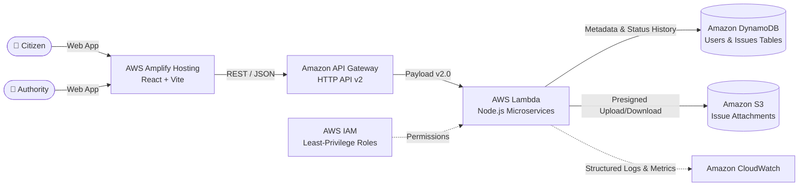

# SWADESH — Crowdsourced Civic Issue Platform

SWADESH is a modern, lightweight, crowdsourced civic issue reporting and redressal platform designed for Indian municipal wards and urban communities. It empowers citizens to report everyday infrastructure problems (such as potholes, uncollected garbage, dysfunctional streetlights, and water leakage), vote on neighborhood priorities, and track resolutions in real time. For municipal authorities, SWADESH provides a centralized triage dashboard to verify, assign, track SLAs, and resolve civic grievances transparently.

---

## 🏛️ Architecture Summary

SWADESH follows a clean, serverless, cost-effective AWS architecture tailored for agility, resilience, and minimal operational overhead:



### Core Architecture Components:
1. **Frontend Hosting (AWS Amplify)**: Delivers a responsive Single Page Application (SPA) built with React and Vite, globally distributed via Amazon CloudFront CDN.
2. **API Gateway (HTTP API v2)**: Low-latency, cost-effective entry point routing requests, handling CORS, and passing JSON payloads to Lambda.
3. **Compute (AWS Lambda)**: Stateless, event-driven Node.js functions implementing authentication, authorization (JWT), issue state machine transitions, and pre-signed S3 URL generation. Supports both AWS cloud execution and local in-memory/file-based mock modes.
4. **Database (Amazon DynamoDB)**:
   - `swadesh-users`: User profiles, roles (`citizen` vs `authority`), and credential hashes.
   - `swadesh-issues`: Issues, category, location coords, status history timeline, and vote counters with GSIs for status-based and reporter-based queries.
5. **Storage (Amazon S3)**: Secure object storage for citizen-uploaded issue photos using presigned PUT/GET URLs to eliminate compute bottlenecks.
6. **Security & Observability (AWS IAM & Amazon CloudWatch)**: Role-based least-privilege IAM policies, detailed execution logs, alarm metrics, and SLA monitoring.

---

## 📁 Repository Structure

```
SWADESH CCL/
├── docs/                      # Single source of truth specifications & designs
│   ├── BLUEPRINT.md           # Authoritative data model, enums, endpoints & rules
│   ├── DESIGN.md              # UI design system tokens, color palette & typography
│   └── screens/               # Stitch design exports (HTML prototypes & PNG assets)
│       ├── 01_home_feed.html / .png
│       ├── 02_report_an_issue.html / .png
│       ├── 03_my_reports.html / .png
│       ├── 04_issue_detail_pothole.html / .png
│       ├── 05_authority_dashboard.html / .png
│       ├── 06_login.html / .png
│       ├── 07_authority_issue_review.html / .png
│       ├── 08_illustration_street_scene.png
│       ├── index.html         # Interactive local screen viewer gallery
│       └── README.md
├── frontend/                  # Vite + React web application
│   └── .gitkeep
├── backend/                   # AWS Lambda serverless backend functions & handlers
│   └── .gitkeep
├── scripts/                   # Seeding, migration, and automation helper scripts
│   └── .gitkeep
├── .env.example               # Reference template for all environment variables
├── .gitignore                 # Root gitignore for Node, build outputs & local mocks
└── README.md                  # Project overview & documentation
```

---

## 🚀 How to Run Locally

SWADESH features a zero-cloud local development environment: the entire stack runs directly on your laptop with in-memory persistence, local image file streaming, and API Gateway v2 event simulation before touching any AWS infrastructure.

### Prerequisites
- **Node.js**: v20.6.0+ (v22+ recommended) for built-in `--env-file` and `node:test` runner.
- **npm** (or pnpm / yarn)

---

### Step 1: Environment Configuration

Both backend and frontend come with ready-to-run `.env.example` templates.

1. **Backend Environment**:
   ```bash
   cp backend/.env.example backend/.env
   ```
   *(Defaults: `DATA_STORE=memory`, `S3_MODE=local`, `PORT=3001`, `AUTHORITY_PASSCODE=swadesh-demo`)*

2. **Frontend Environment**:
   ```bash
   cp frontend/.env.example frontend/.env
   ```
   To connect to the local backend dev server, ensure `VITE_USE_MOCK=false`:
   ```ini
   VITE_API_BASE_URL=http://localhost:3001
   VITE_USE_MOCK=false
   ```
   *(Set `VITE_USE_MOCK=true` if you wish to run the frontend entirely standalone in browser memory).*

---

### Step 2: Start the Backend Dev Server

The dev server runs pure Node.js on port 3001 with `--watch` file reloading, converts HTTP requests to API Gateway HTTP API v2 events, handles local S3 photo uploads (`backend/.local-uploads`), and provides permissive CORS for the frontend:

```bash
cd backend
npm install
npm run dev
```
*Server output:*
```
🚀 SWADESH Backend Dev Server listening at http://localhost:3001
   - Data Store: memory
   - S3 Storage: local (backend/.local-uploads)
   - Permissive CORS active for http://localhost:5173
```

---

### Step 3: Seed Sample Data (20 Realistic Issues)

In a separate terminal, run the public API seeder to populate realistic civic grievances across Mumbai municipal wards:

```bash
# From workspace root:
node scripts/seed.mjs
# or:
npm run seed
```

This creates 20 issues across all 6 categories, logs upvotes from citizen personas, and progresses issues through triage stages (`VERIFIED`, `ASSIGNED`, `IN_PROGRESS`, `RESOLVED`, `REJECTED`).

---

### Step 4: Start the Frontend Application

```bash
cd frontend
npm install
npm run dev
```
Open your browser at **`http://localhost:5173`**.

---

### 🔑 Demo Logins

| Persona | Name | Email | Role | Passcode |
|---|---|---|---|---|
| **Citizen** | Asha Patil | `asha.patil@example.com` | `citizen` | *(None required)* |
| **Citizen** | Rahul Sharma | `rahul.sharma@example.com` | `citizen` | *(None required)* |
| **Authority** | JE Nilesh Sawant | `nilesh.sawant@mcgm.gov.in` | `authority` | `swadesh-demo` |
| **Authority** | EE Rajesh Kulkarni | `rajesh.kulkarni@mcgm.gov.in` | `authority` | `swadesh-demo` |

---

### 🧪 Running Test Suites

- **Backend Test Suite (154 Tests)**:
  ```bash
  npm --prefix backend test
  ```
  *Tests config validation, error handling, validators, routers, storage/presigned URLs, workflow transitions, citizen/authority API handlers, dev-server, and seeding.*

- **Frontend E2E Loop Test (31 Assertions)**:
  ```bash
  npm --prefix frontend run test:e2e
  ```

---

## 📖 Specifications Reference
- Refer to [`docs/BLUEPRINT.md`](docs/BLUEPRINT.md) before implementing or modifying any data types, API endpoints, status transitions, or environment configurations.
- Refer to [`docs/DESIGN.md`](docs/DESIGN.md) for UI color tokens, font configurations, and component sizing.

